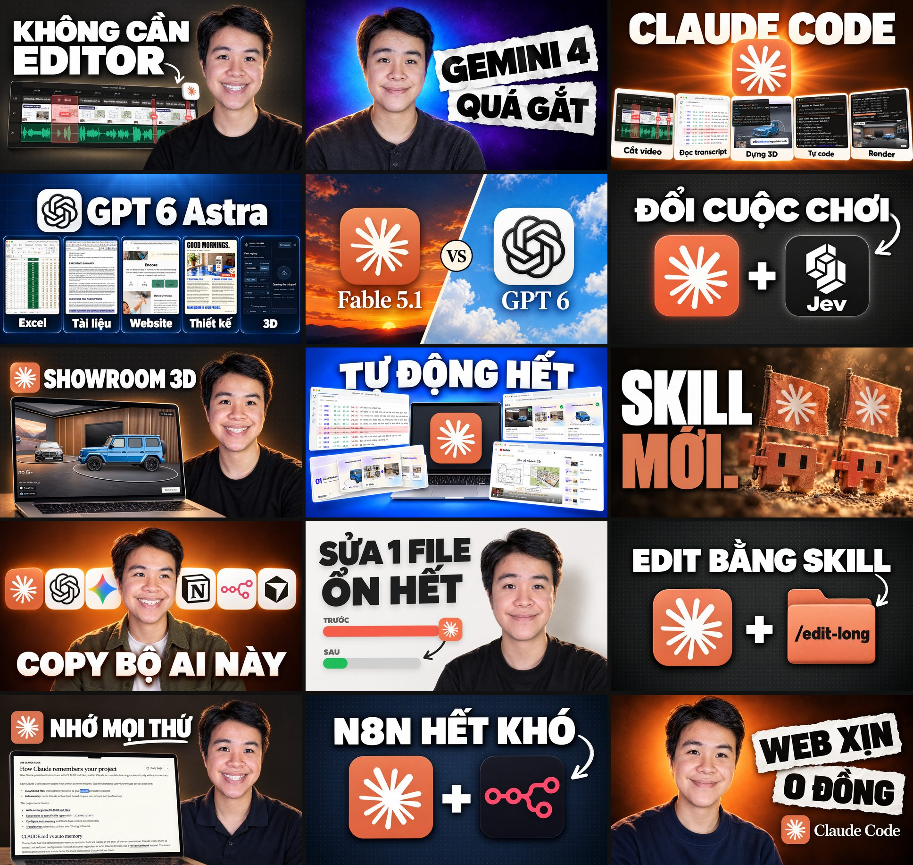
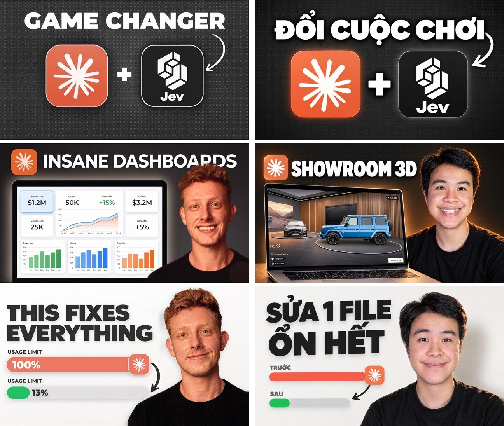

# thumbnail-reverse

Skill cho Claude Code: đưa link 1 kênh YouTube và ảnh mặt của bạn, Claude đọc N thumbnail mới nhất của kênh đó, rút ra luật chung, khuôn bố cục và bộ prompt. Sau đó Claude tạo bộ thumbnail cùng gu cho video của bạn, dùng mặt thật, logo thật, UI thật, tạo ảnh bằng Codex CLI (gói ChatGPT bạn đang login, không cần API key).



15 thumbnail trên làm trong khoảng 1 tiếng rưỡi, học từ 15 video mới nhất của kênh [Ben AI](https://www.youtube.com/@BenAI92). Mặt là ảnh thật của tác giả, logo tải từ App Store và Wikimedia Commons, UI crop từ chính video.

So 3 cặp, bên trái là thumbnail gốc của Ben AI, bên phải là bản mới:



## Làm được gì

- Tải N thumbnail mới nhất của 1 kênh (bỏ qua Shorts) và ghép sheet để Claude đọc 1 lần.
- Rút luật chung (số thành phần, chữ, màu, mặt, chi tiết lặp lại) và khuôn bố cục, mỗi khuôn ghi kèm số thứ tự ảnh mẫu.
- Khối prompt dùng chung giữ mặt giống thật: tả đặc điểm mặt của bạn, chỉ retouch nhẹ, đổi áo khi cần.
- Tải logo thật (App Store có lọc hãng phát hành, Wikimedia Commons, website chính chủ) và tách biểu tượng khỏi logo dạng chữ.
- Gửi ảnh mặt + logo + UI vào Codex làm ảnh tham chiếu, mỗi ảnh ghi rõ vai trò. Quá 5 ảnh thì tự gộp thành 1 tấm sheet có nhãn.
- Test 3 mẫu cho bạn duyệt rồi mới làm số còn lại, chạy 4 job song song.
- Ghép ảnh review: lưới kết quả và ảnh so cặp mẫu gốc với bản mới.

## Yêu cầu

- [Claude Code](https://claude.com/claude-code)
- [Codex CLI](https://github.com/openai/codex) đã login bằng tài khoản ChatGPT gói trả phí. Gói Free không có tool tạo ảnh trong Codex CLI. Mỗi ảnh tốn khoảng 23-46k token quota Codex.
- Python 3 có Pillow (`pip install pillow`)
- [yt-dlp](https://github.com/yt-dlp/yt-dlp) để lấy danh sách video của kênh
- ffmpeg nếu muốn trích frame UI từ video

## Cài đặt

Copy thư mục này vào `~/.claude/skills/`:

```bash
# macOS / Linux
git clone https://github.com/thanhthuduc99/thumbnail-reverse ~/.claude/skills/thumbnail-reverse

# Windows (PowerShell)
git clone https://github.com/thanhthuduc99/thumbnail-reverse "$env:USERPROFILE\.claude\skills\thumbnail-reverse"
```

## Cách dùng

Mở Claude Code trong 1 thư mục trống, gõ ví dụ:

```
Reverse thumbnail kênh https://www.youtube.com/@BenAI92, xem 15 cái mới nhất.
Làm thumbnail cùng gu cho 15 video của mình, mặt mình trong thư mục D:/headshots.
Màu tự do theo logo tool trong video. Đôi lúc đổi áo cho khác. Test 3 cái trước, ok rồi mới làm tiếp.
```

Hoặc gọi thẳng `/thumbnail-reverse`.

## Quy trình

| Bước | Việc | Ai quyết |
|---|---|---|
| 0 | Chốt kênh mẫu, ảnh mặt, màu, danh sách video, nguồn UI | Bạn |
| 1 | Tải thumbnail, ghép sheet để đọc | Claude |
| 2 | Rút luật chung + khuôn bố cục (ghi số ảnh mẫu) | Claude |
| 3 | Viết khối prompt chung, tả đặc điểm mặt của bạn | Claude |
| 4 | Tải logo thật, crop UI thật | Claude |
| 5 | Viết prompt từng ảnh | Claude |
| 6 | **Dừng** gửi 3 mẫu test + ảnh so cặp | **Bạn duyệt** |
| 7 | Làm số còn lại, 4 job song song | Claude |
| 8 | Ghép review, báo lỗi còn lại và token đã tốn | Claude |

Prompt mẫu cho 1 thumbnail (khối PERSON, STYLE, TEXT RULES dùng chung được ghép vào lúc build):

```
Create a photorealistic YouTube thumbnail, 16:9 landscape.

LAYOUT:
- Background: dark charcoal #232323 with a fine dot-grid texture, a soft warm glow and a vignette.
- Top-left: the attached Claude app icon as a small rounded square, followed by the white headline "SHOWROOM 3D" on one line, about 60% of the frame width.
- Bottom-left: a real silver laptop, screen facing the viewer, showing the attached real 3D showroom screenshot full screen.
- Right 38% of the frame: the person from the reference photos, chest-up, head large, body cut off by the bottom edge.

[khối prompt chung, với:]
expression = big friendly smile with teeth, eyes looking straight into the lens
wardrobe = plain black crew-neck t-shirt
palette = charcoal and warm light; color comes from the showroom screenshot and the Claude icon
exact text = "SHOWROOM 3D"
```

Đủ 15 prompt đã duyệt nằm trong `references/ben-ai-example.md`. Muốn dùng ChatGPT web thay Codex: dán file `prompts/<tên>.txt` vào ChatGPT và đính kèm đúng các ảnh như lệnh `gen_thumb.py`.

## Cấu trúc

```
SKILL.md                    quy trình 8 bước
scripts/
  fetch_channel_thumbs.py   tải N thumbnail mới nhất của kênh + list.txt
  sheet.py                  ghép ảnh thành lưới có nhãn (đọc mẫu, chọn ảnh mặt, so cặp, review)
  fetch_logo.py             tải logo thật, --icon tách biểu tượng khỏi logo dạng chữ
  build_prompts.py          build prompts.md thành prompts/<tên>.txt, báo lỗi nếu còn placeholder
  gen_thumb.py              gọi codex exec với ảnh mặt + asset thật, ra out/<tên>.png
template/prompts.md         khung luật, khuôn, khối prompt chung (có chỗ điền đặc điểm mặt)
references/
  ben-ai-example.md         ví dụ đầy đủ: luật Ben AI, 5 khuôn, 15 prompt đã duyệt
  pitfalls.md               bẫy đã gặp: mặt, logo, UI, màu, chữ, Codex
```

## Ghi chú

- Kênh mẫu chỉ dùng để học bố cục và luật. Repo không chứa ảnh gốc của kênh mẫu, trừ 3 thumbnail của Ben AI trong ảnh so sánh ở trên. Thumbnail mới không dùng lại chữ, ảnh hay mặt của kênh mẫu.
- Chỉ dùng ảnh mặt của chính bạn hoặc người đã đồng ý.
- Logo và tên sản phẩm thuộc về chủ sở hữu của chúng.
- 15 thumbnail trong `docs/media/` có mặt thật của tác giả, chỉ để minh hoạ.

Tác giả: Thành Vũ Đức (Contentta). License MIT.
